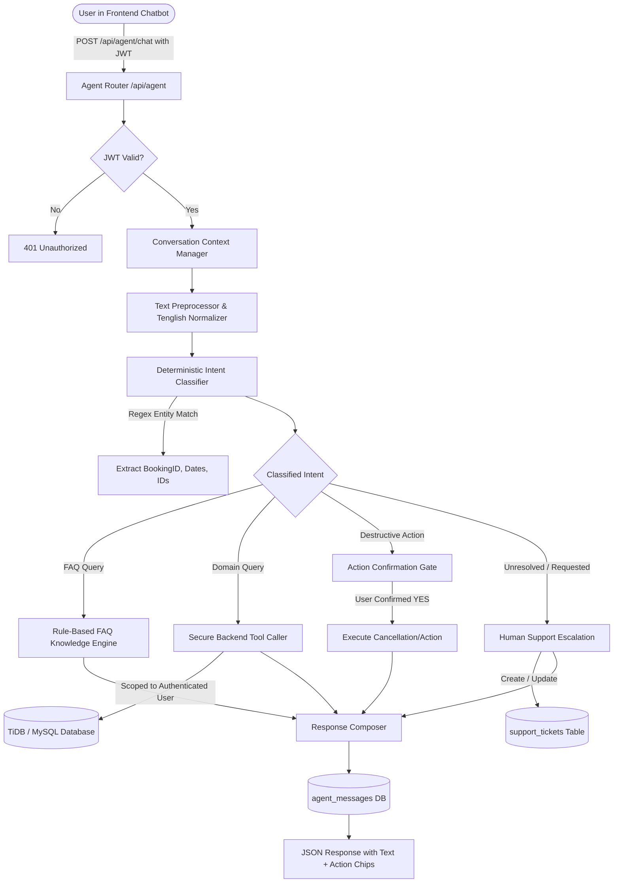

# PAYENT AGENT — PHASE 1: COMPLETE PROJECT AUDIT REPORT
**Author:** Senior Software Architect & Python/FastAPI Code Auditor  
**Date:** October 30, 2026  
**Scope:** Payent Peer-to-Peer Rental Marketplace & Customer Support Architecture  
**Execution Mode:** Strictly Read-Only Audit (No Code Modified, No Migrations Run, No Deployments)

---

## 1. Executive Summary

Payent is a peer-to-peer tech gear and utility rental marketplace operating across two operational facets: **Payrent** (renter/customer discovery, booking, payments, and delivery tracking) and **Payernt** (vendor/lender gear listing, handover PIN security, order fulfillment, and wallet earnings), mediated by a comprehensive **Payent Admin Panel**.

This audit was conducted to assess the feasibility and architectural roadmap for replacing/upgrading the existing customer support agent into a **custom, standalone Python-based deterministic customer support engine** adhering to strict technological constraints:
- **No external AI APIs or cloud LLMs** (Zero dependency on OpenAI, Gemini, Claude, Cohere, etc.).
- **No local neural networks or heavy ML runtimes** (Zero dependency on Ollama, HuggingFace Transformers, PyTorch, llama.cpp).
- **Custom rule-based Python architecture**: Intent classification, regex entity extraction, keyword/synonym taxonomy, Telugu-English ("Tenglish") phrase matching, authenticated database tool callers, two-step action confirmation, and seamless escalation to human administrators.

### Core Findings Matrix
| Component / Capability | Status | Key Observation |
| :--- | :--- | :--- |
| **Current Chatbot (`HelpChatbot.tsx`)** | `EXISTING` (Mock Only) | Pure frontend simulation using hardcoded TypeScript string matches; zero backend persistence, zero auth awareness, zero database integration. |
| **"Agents" Module in Admin / DB** | `EXISTING` (Terminology Conflict) | The `agents` SQL table and `/admin/agents` dashboard route refer strictly to **Human Equipment Hosts/Lenders** ("Agent Lenders"), not an AI or support bot. |
| **Support Ticket Infrastructure** | `EXISTING` | Dedicated `support_tickets` SQL table, customer support portal (`/support`), admin support management console (`/admin/support`), and REST APIs for thread conversations. |
| **Human Support Escalation** | `PARTIALLY IMPLEMENTED` | Tickets can be created, viewed, replied to, and status-managed; however, automated routing, agent role separation, file uploads for tickets, and real-time push alerts are missing. |
| **Reusable Domain Queries** | `EXISTING` | Robust Python helper functions exist for booking lifecycle, payment verification, refund status, delivery tracking, and KYC lookup. |
| **Lightweight Pure-Python NLP** | `EXISTING` (Reference Pattern) | `backend/search_ml.py` already implements pure-Python tokenization, Levenshtein distance, and TF-IDF scoring with zero external AI packages. |

---

## 2. Existing Project Architecture

The Payent repository is structured as a full-stack monorepo with distinct separation between client, server, and administrative tooling:

```
c:\payernt-main\payernt-main\
├── backend\                 # Python 3.14 / FastAPI asynchronous REST API
│   ├── auth.py              # JWT token issuance, verification, password hashing
│   ├── cloudinary_service.py# Cloudinary media and document management
│   ├── config.py            # Environment configurations, database & CORS settings
│   ├── database.py          # Primary DB connection pool, schema init, business logic (9.2k lines)
│   ├── email_service.py     # Outbound SMTP transaction mailer with logging fallback
│   ├── main.py              # Primary FastAPI router & business endpoints (14.4k lines)
│   ├── payernt_database.py  # Vendor domain database operations & double-PIN security (4.7k lines)
│   ├── payernt_router.py    # Vendor-specific endpoints (/api/payernt/*)
│   ├── recommendations_ml.py# Pure-Python item-to-item similarity
│   └── search_ml.py         # Pure-Python TF-IDF search, tokenization, Levenshtein distance
├── frontend\                # React 19 + TypeScript + Vite + Tailwind CSS + TanStack Router
│   ├── src\
│   │   ├── admin\           # Admin panel layouts, components, services, and route pages
│   │   ├── components\      # Common UI components (Navbar, Modals, HelpChatbot)
│   │   ├── hooks\           # React hooks (useAuth, useProducts, useBookings)
│   │   ├── layouts\         # Layout wrappers (MainLayout, AuthLayout, AdminLayout)
│   │   ├── pages\           # Public customer pages (Support.tsx, Home.tsx, Checkout.tsx)
│   │   ├── payernt\         # Vendor dashboard store, API client, and lifecycle UI
│   │   ├── routes\          # TanStack Router tree
│   │   ├── types\           # Shared TypeScript interfaces
│   │   └── utils\           # API client (api.ts) and validation logic
```

### Key Architectural Characteristics
- **Backend**: FastAPI with async/sync endpoints running on Uvicorn. Data access is facilitated by a central PyMySQL connection pool targeting TiDB Serverless/MySQL, backed by an in-memory dictionary fallback mode (`MOCK_USERS`, `MOCK_ORDERS`, `MOCK_SUPPORT_TICKETS`, etc.) for local offline development.
- **Frontend**: Single Page Application (SPA) with SSR capabilities compiled via Vite (`vite v8.3.2`). Routing is handled by TanStack Router. Global styling utilizes Tailwind CSS and Framer Motion animations.
- **Authentication**: Stateless JSON Web Tokens (`HS256`) carrying `sub` (email), `role` (`customer`, `lender`, `vendor`, `admin`, `superadmin`), and `account_type` (`pay₹ent`, `payrent`, `payernt`). Tokens are persisted in `localStorage` under keys `payent:token`, `payent_token`, `payernt_token`, and `paye₹nt_token`.

---

## 3. Frontend File Structure

### Relevant Frontend Components & Routes
| Path | Type | Responsibility / Capabilities | Status |
| :--- | :--- | :--- | :--- |
| `frontend/src/components/common/HelpChatbot.tsx` | UI Component | Floating widget rendering simulated Q&A about rental gear, damage protection, and rates. | `EXISTING` |
| `frontend/src/routes/__root.tsx` | Root Layout | Globally mounts `<HelpChatbot />` conditionally on non-gateway, non-payernt routes (`showChatbot && !isGateway && !isPayernt`). | `EXISTING` |
| `frontend/src/pages/Support.tsx` | Customer Page | Comprehensive support portal: search bar, 5 FAQ categories, troubleshooting steps, interactive ticket submission modal, and active conversation viewer. | `EXISTING` |
| `frontend/src/routes/support.tsx` | Route | TanStack route definition linking to `frontend/src/pages/Support.tsx`. | `EXISTING` |
| `frontend/src/routes/faq.tsx` | Route | Renders general FAQ categories and direct support links. | `EXISTING` |
| `frontend/src/admin/pages/Support.tsx` | Admin Page | Dedicated support management dashboard: search, status filter tabs, conversation thread viewer, admin reply form, and status toggles. | `EXISTING` |
| `frontend/src/routes/admin/support.tsx` | Admin Route | Route `/admin/support` protected by admin authentication guard. | `EXISTING` |
| `frontend/src/admin/pages/Agents.tsx` | Admin Page | Directory and suspension controls for **Agent Lenders** (equipment hosts). Not an AI bot console. | `EXISTING` |
| `frontend/src/routes/admin/agents.tsx` | Admin Route | Route `/admin/agents` for managing equipment lenders. | `EXISTING` |
| `frontend/src/utils/api.ts` | Service Client | Contains `getSupportTickets()`, `createSupportTicket()`, `replyToConversation()`, `getConversation()`. | `EXISTING` |
| `frontend/src/admin/services/notifications.ts` | Admin Service | Admin API client wrapping `/api/admin/support`, `/api/admin/support/{id}/reply`, `/api/admin/support/{id}/status`. | `EXISTING` |

---

## 4. Backend File Structure

### Relevant Backend Modules & Routers
| Path | Lines | Responsibility / Capabilities | Status |
| :--- | :--- | :--- | :--- |
| `backend/main.py` | 14,397 | Main application. Hosts `/api/support`, `/api/messages`, `/api/admin/support`, booking `/api/orders`, payments `/api/payments/*`, KYC `/api/kyc/*`, and delivery `/api/deliveries/*`. | `EXISTING` |
| `backend/database.py` | 9,261 | DB schema init (`init_db`), connection pool, SQL executors, safe table/column migrators, mock dictionaries, and domain query helper functions. | `EXISTING` |
| `backend/payernt_database.py` | 4,776 | Dedicated vendor and rental security tables (`payernt_accounts`, `payernt_products`, `rental_security`, `payernt_messages`, `payernt_wallets`). | `EXISTING` |
| `backend/payernt_router.py` | 3,100 | Vendor endpoints (`/api/payernt/*`) covering vendor bookings, inventory management, handover OTP/PIN checks, and wallet withdrawals. | `EXISTING` |
| `backend/search_ml.py` | 269 | Pure-Python search engine utilizing string tokenization, Levenshtein distance, TF-IDF weights, and cosine similarity. | `EXISTING` |
| `backend/auth.py` | 145 | Token generation (`create_access_token`), token decoding (`decode_token`), bcrypt hashing (`verify_password`, `get_password_hash`). | `EXISTING` |
| `backend/email_service.py` | 130 | Outbound email templates and SMTP dispatcher with error suppression. | `EXISTING` |

---

## 5. Existing Payent Agent Analysis

### 5.1 Chatbot UI & Placement (`frontend/src/components/common/HelpChatbot.tsx`)
- **Mounting**: Rendered in `frontend/src/routes/__root.tsx#L247` with visibility flag `showChatbot && !isGateway && !isPayernt`.
- **Display**: A floating circular trigger button in the bottom right corner (`fixed bottom-6 right-6 z-40 hidden lg:flex`), opening a 380px x 540px glassmorphism chat panel.
- **Mobile Restriction**: The floating button is hidden on mobile screens due to Tailwind's `hidden lg:flex` class.
- **Trigger Event**: Listens to `window.addEventListener("open-payent-help-chat", handleOpen)`.

### 5.2 Processing Flow & Response Logic
- **Purely Client-Side**: When the user enters text, `handleSend(text)` executes entirely inside the browser.
- **Simulation Delay**: Uses `setTimeout(() => { ... }, 1000)` to simulate "thinking" latency.
- **Keyword Matching Engine**: `generateBotResponse(query)` performs case-insensitive regex checks on the user input string:
  - Bikes/Scooters: `q.includes("bike") || q.includes("scooter") || q.includes("activa")`
  - Drills/Tools: `q.includes("drill") || q.includes("tool") || q.includes("bosch")`
  - Powerbanks: `q.includes("power") || q.includes("bank") || q.includes("charger")`
  - Cameras: `q.includes("camera") || q.includes("sony") || q.includes("lens")`
  - Laptops/Drones: `q.includes("laptop") || q.includes("macbook") || q.includes("drone")`
  - Insurance: `q.includes("deposit") || q.includes("security") || q.includes("insur")`
  - Lender Earnings: `q.includes("earn") || q.includes("lend") || q.includes("list")`
  - Locations: `q.includes("city") || q.includes("cities") || q.includes("locat")`
  - Greetings: `/hi|hello|hey|namaste/i.test(q)`
- **Dynamic Catalog Enrichment**: Upon opening, executes `Promise.all([api.getPublicProducts(), api.getPublicCategories()])` to list real products and prices in its hardcoded template answers.

### 5.3 Limitations & Deficiencies of Current Agent
1. **Zero Backend Persistence**: Messages are stored solely in React state (`useState<Message[]>`). Refreshing or navigating closes the session and wipes all history.
2. **Zero Database Integration**: Cannot look up an active booking, check delivery status, verify payment receipts, or inspect a renter's KYC.
3. **No User Context**: Operates anonymously; does not inspect authentication headers or identify who is asking.
4. **No Escalation Mechanism**: Cannot create a support ticket, page a customer representative, or transfer the thread to the Admin Support dashboard.
5. **No Mutation Capabilities**: Cannot perform safe guided actions (e.g., cancellation requests, address updates, dispute lodging).
6. **No Telugu / Vernacular Support**: Queries in Telugu or Telugu-English ("na booking cancel cheyandi", "refund eppudu vastadi") hit the default fallback error response.
7. **Mobile Inaccessibility**: The desktop-only CSS class (`hidden lg:flex`) prevents mobile users from accessing the assistant.

---

## 6. Database Schema and Relationships

All table definitions were directly verified from `backend/database.py` and `backend/payernt_database.py`.

### 6.1 Core Tables Matrix
| Table Name | Defined In | Primary Key | Key Foreign Keys / Relations | Purpose | Status |
| :--- | :--- | :--- | :--- | :--- | :--- |
| `users` | `database.py:309` | `email` (VARCHAR) | `person_id` -> `persons.id` | Renter & user identities, role, KYC status, contact info. | `EXISTING` |
| `orders` | `database.py:536` | `id` (VARCHAR) | `user_email` -> `users.email`, `product_id` -> products, `lender_email` | Renter bookings, schedule dates, payment status, delivery method. | `EXISTING` |
| `custom_products` | `database.py:701` | `id` (VARCHAR) | `user_email` -> `users.email` | Payrent rental catalog items. | `EXISTING` |
| `payernt_products` | `payernt_database.py:86` | `id` (VARCHAR) | `owner_id` -> `payernt_accounts.id`, `owner_email` | Payernt vendor gear listings, rates, secret PIN. | `EXISTING` |
| `rental_security` | `payernt_database.py:171` | `id` (VARCHAR) | `booking_id` (UNIQUE) -> `orders.id` | Handover security, double-PIN activation, escrow deposit. | `EXISTING` |
| `payments` | `database.py:915` | `id` (VARCHAR) | `booking_id` -> `orders.id`, `customer_id` | Payment receipts, Razorpay identifiers, transaction amounts. | `EXISTING` |
| `booking_cancellations` | `database.py:631` | `id` (VARCHAR) | `booking_id` -> `orders.id`, `lender_id`, `renter_id` | Cancellation audit log, reason codes, policy outcomes. | `EXISTING` |
| `user_kyc_verifications` | `database.py:375` | `id` (VARCHAR) | `email` -> `users.email`, `user_id` | Government ID verification (PAN/Aadhaar), status, review notes. | `EXISTING` |
| `deliveries` | `database.py:1008` | `id` (VARCHAR) | `booking_id` -> `orders.id`, `delivery_boy_id` | Live tracking, transit coordinates, ETA, delivery status. | `EXISTING` |
| `delivery_location_updates` | `database.py:1046` | `id` (VARCHAR) | `delivery_id` -> `deliveries.id` | Breadcrumb coordinate stream for active couriers. | `EXISTING` |
| `support_tickets` | `database.py:864` | `id` (VARCHAR) | `user_email` -> `users.email`, `booking_id` (in JSON/columns) | Customer support inquiries, message history, status, priority. | `EXISTING` |
| `conversations` | `database.py:1062` | `id` (VARCHAR) | `booking_id` -> `orders.id`, `customer_email`, `lender_email` | P2P renter-lender chat thread metadata. | `EXISTING` |
| `conversation_members` | `database.py:1082` | `id` (VARCHAR) | `conversation_id` -> `conversations.id`, `user_email` | Membership and read receipts for P2P chat. | `EXISTING` |
| `messages` | `database.py:1098` | `id` (VARCHAR) | `conversation_id` -> `conversations.id`, `sender_email` | Individual chat messages with text content and deletion audit. | `EXISTING` |
| `message_attachments` | `database.py:1122` | `id` (VARCHAR) | `message_id` -> `messages.id` | Uploaded images/files attached to chat messages. | `EXISTING` |
| `notifications` | `database.py:771` | `id` (VARCHAR) | `user_email` -> `users.email`, `booking_id` | In-app user notifications with read status and event keys. | `EXISTING` |
| `admin_notifications` | `database.py:852` | `id` (VARCHAR) | None | System alerts dispatched to platform administrators. | `EXISTING` |
| `admin_logs` | `database.py:903` | `id` (VARCHAR) | None | Administrative action audit trail (action, module, IP). | `EXISTING` |
| `agents` | `database.py:759` | `id` (VARCHAR) | `user_email` -> `users.email` | **Agent Lenders** (human product owners). Terminology distinction! | `EXISTING` |

### 6.2 The Dual Messaging Architecture
The codebase currently contains **two distinct communication data models**:
1. **Support Tickets Model (`support_tickets`)**: Used by `/api/support` and `/api/admin/support`. Stores thread messages as a JSON array serialized in the `messages LONGTEXT` column. Simple, single-row thread loading, but lacks relational integrity for per-message indexing or file attachments.
2. **Normalized Chat Model (`conversations`, `conversation_members`, `messages`, `message_attachments`)**: Used for direct peer-to-peer messaging between customer and lender. Fully normalized with per-message timestamps, read receipts, and attachments.

---

## 7. Existing API Endpoints

### 7.1 Support & Messaging Endpoints
| Endpoint Path | Method | Auth Guard | Request Body / Parameters | Function Name | Status |
| :--- | :--- | :--- | :--- | :--- | :--- |
| `/api/support` | `GET` | User JWT | None | `fetch_user_conversations` (Line 5800) | `EXISTING` |
| `/api/messages` | `GET` | User JWT | None | Alias to `fetch_user_conversations` | `EXISTING` |
| `/api/support` | `POST` | User JWT | `CreateSupportTicketSchema` (`subject`, `message`, `category`, `priority`, `bookingId`, `productReference`) | `create_user_support_ticket` (Line 6021) | `EXISTING` |
| `/api/messages/new` | `POST` | User JWT | `NewConversationSchema` (`subject`, `message`, `category`) | `create_new_conversation` (Line 5940) | `EXISTING` |
| `/api/messages/{id}` | `GET` | User JWT | Path `id` | `fetch_conversation_detail` (Line 5847) | `EXISTING` |
| `/api/messages/{id}/reply` | `POST` | User JWT | `ConversationReplySchema` (`message`) | `reply_to_conversation` (Line 5881) | `EXISTING` |
| `/api/messages/{id}/read` | `POST` / `PATCH` | User JWT | Path `id` | `mark_support_ticket_read` (Line 5994) | `EXISTING` |
| `/api/admin/support` | `GET` | Admin JWT | None | `admin_support_tickets_list` (Line 12953) | `EXISTING` |
| `/api/admin/support/{id}/reply` | `POST` | Admin JWT | `SupportReplySchema` (`message`) | `admin_reply_support_ticket` (Line 12999) | `EXISTING` |
| `/api/admin/support/{id}/status` | `POST` | Admin JWT | `SupportStatusSchema` (`status`) | `admin_status_support_ticket` (Line 13074) | `EXISTING` |

### 7.2 Core Domain Endpoints Relevant for Agent Tool Calling
| Domain | Endpoint Path | Method | Auth Guard | Key Return Data |
| :--- | :--- | :--- | :--- | :--- |
| **Bookings** | `/api/orders` | `GET` | User JWT | List of current user's active & past orders. |
| **Bookings** | `/api/orders/{id}` | `GET` | User/Admin JWT | Full order details, dates, payment status, delivery info. |
| **Bookings** | `/api/bookings/{id}` | `GET` | User/Admin JWT | Normalized booking details view with vendor information. |
| **Cancellation** | `/api/orders/{id}/cancel` | `POST` | User JWT | Cancels unfulfilled booking and triggers release. |
| **Cancellation** | `/api/orders/{id}/cancellation-request` | `POST` | User JWT | Submits structured cancellation request with reason. |
| **Delivery** | `/api/orders/{id}/location` | `GET` | User/Admin JWT | Current delivery stage, courier name/phone, coordinates. |
| **Delivery** | `/api/deliveries/{id}` | `GET` | User/Admin JWT | Delivery status, addresses, ETA in minutes. |
| **KYC** | `/api/kyc/status` | `GET` | User JWT | Verification state (`NOT_STARTED`, `PENDING`, `APPROVED`, `REJECTED`). |
| **Catalog** | `/api/products/{id}` | `GET` | Public / None | Item specifications, daily rate, availability status. |
| **Payments** | `/api/admin/payments` | `GET` | Admin JWT | Transaction list, payment status, Razorpay payment ID. |

---

## 8. Reusable Backend Services

The following backend service functions are already written, tested, and directly importable as tools for the custom Python agent:

```python
# 1. Booking & Order Information
from database import get_order_by_id, get_orders
# - get_order_by_id(order_id: str) -> Optional[dict]
# - get_orders(user_email: str) -> List[dict]

# 2. Product Information & Availability
from database import find_authoritative_product, evaluate_product_availability
# - find_authoritative_product(product_id: str) -> Optional[dict]
# - evaluate_product_availability(product: dict) -> Tuple[bool, str, Optional[str]]

# 3. Delivery Tracking & Location
from database import get_delivery_by_booking, get_delivery, get_delivery_locations
# - get_delivery_by_booking(booking_id: str) -> Optional[dict]
# - get_delivery(delivery_id: str) -> Optional[dict]

# 4. User KYC Verification Status
from database import get_user_kyc_status
# - get_user_kyc_status(email: str, account_type: str) -> Dict[str, Any]

# 5. Cancellation Execution & Audit
from database import record_booking_cancellation, cancel_order, get_booking_cancellation
# - record_booking_cancellation(booking_id, product_id, lender_id, renter_id, reason_code, ...)

# 6. User Verification & Account Profile
from database import get_user
# - get_user(email: str) -> Optional[dict]

# 7. Notification Ingestion
from database import notify_booking_event, record_admin_notification
# - notify_booking_event(order_id: str, event_type: str, custom_message: Optional[str])
```

---

## 9. Existing FAQ and Support Functionality

### 9.1 Structured FAQ Taxonomy (`frontend/src/pages/Support.tsx`)
The customer support portal defines a comprehensive, battle-tested taxonomy of rental issues across 5 core categories with structured troubleshooting steps:
1. **Rental & Product Issues (`rental-product`)**:
   - `rp-1`: Product not working (cable checks, battery seating, replacement within 2h).
   - `rp-2`: Arrived damaged (photo evidence, liability attribution).
   - `rp-3`: Accessories/cables missing.
   - `rp-4`: Product differs from listing photo.
   - `rp-5`: Technical failure during shoot.
   - `rp-6`: Reporting damage process.
   - `rp-7`: Unsafe equipment protocol.
2. **Billing & Payments (`billing-payments`)**:
   - Security deposit waiver rules, rental extensions, refund timelines (5-7 business days via Razorpay).
3. **Previous Orders (`previous-orders`)**:
   - Return pickup scheduling, lender handover disputes, delayed courier returns.
4. **App & Technical Support (`app-technical`)**:
   - OTP delivery failure, device login verification, Secret PIN reveal.
5. **General Help (`general-help`)**:
   - Insurance policy limit (₹5 Lakhs damage cover), zero security deposit criteria.

### 9.2 Search & Troubleshooting UI
- Search input with real-time text matching against questions and answers.
- Filter buttons by category with interactive tab counts.
- Troubleshooting step-by-step accordion.
- Was this helpful? (`ThumbsUp` / `ThumbsDown` feedback buttons).
- Direct "Raise a Ticket" modal pre-populating the category and product/booking context.

---

## 10. Human Support Capabilities

| Capability | Status | Implementation Details / Verification |
| :--- | :--- | :--- |
| **Support Ticket Creation** | `EXISTING` | `POST /api/support` persists to `support_tickets` with `id` (`TICK-...` or `CONV-...`). |
| **Ticket Categories** | `EXISTING` | Persisted in `support_tickets.category` (e.g. `Rental & Product Issues`, `Billing & Payments`). |
| **Ticket Status Management** | `EXISTING` | Statuses: `open`, `pending`, `in_progress`, `resolved`, `closed`. Admin toggles via `POST /api/admin/support/{id}/status`. |
| **Admin Support Dashboard** | `EXISTING` | Verified in `frontend/src/admin/pages/Support.tsx` with search, filter tabs, thread viewer, and reply input. |
| **Support Agent Roles** | `MISSING` | System currently has only `admin` / `superadmin` / `user` / `lender`. There is no dedicated `support_agent` role with restricted permission boundaries. |
| **Agent Assignment** | `MISSING` | `support_tickets` table has no `assigned_to` or `assigned_agent_id` column. Tickets cannot be routed to specific operators. |
| **Conversation History** | `EXISTING` | Messages stored sequentially in `support_tickets.messages` (JSON string array) and `conversations`/`messages`. |
| **File Attachments in Tickets** | `PARTIALLY IMPLEMENTED` | `message_attachments` table exists in schema, but `support_tickets` has no attachment upload or URL fields. |
| **Support Notifications** | `PARTIALLY IMPLEMENTED` | In-app notification infrastructure exists (`notifications` table), but creating or replying to a ticket does not currently dispatch alerts to user or admin. |

---

## 11. Authentication and Security Findings

### 11.1 Access Control & Token Architecture
- **JWT Verification**: Validated in `backend/auth.py` via `decode_token(token)`. Checks algorithm (`HS256`), expiry (`exp`), and blacklisting (`token_blocklist` table).
- **Endpoint Protection**:
  - Customer endpoints depend on `get_current_user_email` or `get_current_any_user_email`.
  - Admin endpoints depend on `check_admin_user`, which validates that `role in ("admin", "superadmin")`.
  - Vendor endpoints depend on `get_current_payernt_account`.

### 11.2 Identified Security Considerations
1. **Chat Access Isolation (`backend/main.py#L5857-L5860`)**:
   - `fetch_conversation_detail` enforces: `if ticket.get("user_email") != clean_email and role not in ("admin", "superadmin"): raise HTTPException(403)`.
   - **Requirement for Custom Agent**: Any automated database tool calling (e.g., fetching orders, checking refunds) must strictly inject the authenticated session email `current_user_email` into the database query to prevent Insecure Direct Object References (IDOR).
2. **Action Confirmation Boundary**:
   - Automated destructive actions (e.g., booking cancellation via chat) must never be executed on a single turn. A two-phase confirmation protocol (State: `PENDING_CONFIRMATION`) must be enforced.
3. **Sensitive Information Masking**:
   - In responses generated by the agent, sensitive fields must be sanitized:
     - Payment card / UPI details -> Masked.
     - Aadhaar / PAN numbers -> Masked (`XXXXXXXX1234`).
     - Passwords / PIN hashes -> Never exposed.

---

## 12. Missing Features (Gap Analysis)

To achieve the desired custom Python customer support system, the following components are currently missing:

1. **Backend Agent Endpoint (`POST /api/agent/chat`)**:
   - Currently, there is no backend endpoint that receives chat queries, processes intent, runs tools, and returns structured agent replies.
2. **Persistent Agent Conversation Storage (`agent_conversations` & `agent_messages`)**:
   - Existing chatbot is stateless React memory. There is no table tracking agent chat sessions, user context, active slots, or escalation status.
3. **Python Intent Classification Engine**:
   - No module currently maps text tokens to canonical intents (`CHECK_BOOKING_STATUS`, `CANCEL_BOOKING`, `TRACK_DELIVERY`, `CHECK_REFUND`, `ESCALATE_HUMAN`, `FAQ_QUERY`).
4. **Telugu-English ("Tenglish") Normalization Dictionary**:
   - No lexicon exists to handle Telugu loanwords or phrases commonly used in peer-to-peer transactions in Andhra Pradesh & Telangana.
5. **Stateful Multi-Turn Context Manager**:
   - No session memory to maintain dialogue state across consecutive user messages (e.g., storing the active `booking_id` while waiting for confirmation).
6. **Ticket Escalation Pipeline**:
   - No bridge connecting an unresolved or user-requested chatbot session directly into a `support_tickets` entry with conversation history attached.
7. **Mobile Chatbot UI Accessibility**:
   - Floating button is currently disabled on mobile devices.

---

## 13. Technical Risks and Dependencies

1. **Zero External AI Rule Strictness**:
   - *Risk*: Without an LLM, complex linguistic variations, misspellings, or ambiguous compound queries cannot be resolved through neural embeddings.
   - *Mitigation*: Combine exact keyword tokens, Levenshtein distance thresholds (borrowing from `backend/search_ml.py`), regex pattern extractors, and proactive quick-reply suggestion chips to constrain user inputs to supported paths.
2. **Data Consistency Between Dual Message Stores**:
   - *Risk*: Having both `support_tickets.messages` (JSON string) and `conversations`/`messages` (relational) risks desynchronization if escalation creates records in the wrong table.
   - *Mitigation*: Anchor all human escalation directly to the authoritative `support_tickets` table which powers `/admin/support`.
3. **Database Concurrency in Fallback Mode**:
   - *Risk*: In offline local development without TiDB/MySQL, memory state (`MOCK_SUPPORT_TICKETS`) resets upon server reload.
   - *Mitigation*: Ensure all new schemas and helpers support both live SQL execution and graceful mock fallback, adhering to existing codebase patterns.

---

## 14. Recommended Architecture for Custom Python Agent



### Key Subsystems
1. **`TextPreprocessor`**:
   - Lowercases, strips punctuation, normalizes whitespace.
   - Applies Telugu-English phonetic and transliteration mapping dictionary:
     - *"enti"* / *"ekada"* / *"eppudu"* -> `"what"` / `"where"` / `"when"`
     - *"cancel cheyali"* / *"vadhu"* -> `"cancel"`
     - *"dabulu"* / *"paise"* / *"amount"* -> `"money / refund"`
     - *"pani cheyadam ledu"* -> `"not working / broken"`
2. **`IntentClassifier`**:
   - Priority-based deterministic rule evaluation:
     - Priority 1: Exact command keywords (`"help"`, `"human"`, `"agent"`, `"cancel"`, `"status"`).
     - Priority 2: Regex entity recognition (`ord_[a-zA-Z0-9]+` -> Booking context).
     - Priority 3: Weighted token scoring against intent vocabularies.
     - Priority 4: Fuzzy Levenshtein matching on domain keywords.
     - Fallback: Unrecognized query -> Offer suggestion chips or offer escalation.
3. **`ContextManager`**:
   - Maintains a short-lived conversation state object:
     `{ session_id, user_email, active_intent, pending_action, collected_entities, last_interaction }`.
4. **`ToolCaller`**:
   - Dispatches read-only calls to existing helpers (`get_order_by_id`, `get_delivery_by_booking`, `get_user_kyc_status`) with strict user ownership validation.
5. **`EscalationBridge`**:
   - Invokes `execute_query("INSERT INTO support_tickets ...")` and attaches conversation transcripts so human admins see the context immediately in `/admin/support`.

---

## 15. Proposed Database Changes (Design Only — Not Implemented)

To maintain clean separation between transient chatbot interactions and formal human support tickets, the following database tables are proposed for future phases:

### 15.1 Table: `agent_conversations`
```sql
CREATE TABLE IF NOT EXISTS agent_conversations (
    id VARCHAR(255) PRIMARY KEY,
    user_email VARCHAR(255) NOT NULL,
    session_status VARCHAR(50) DEFAULT 'ACTIVE', -- 'ACTIVE', 'RESOLVED', 'ESCALATED'
    active_intent VARCHAR(100) NULL,
    context_data LONGTEXT NULL,                  -- JSON serialized state (slots, pending action)
    ticket_id VARCHAR(255) NULL,                 -- Linked support_tickets.id upon escalation
    created_at VARCHAR(100) NOT NULL,
    updated_at VARCHAR(100) NOT NULL,
    INDEX idx_ac_user (user_email),
    INDEX idx_ac_status (session_status)
);
```

### 15.2 Table: `agent_messages`
```sql
CREATE TABLE IF NOT EXISTS agent_messages (
    id VARCHAR(255) PRIMARY KEY,
    conversation_id VARCHAR(255) NOT NULL,
    sender_type VARCHAR(20) NOT NULL,            -- 'USER', 'AGENT', 'SYSTEM'
    message_text TEXT NOT NULL,
    matched_intent VARCHAR(100) NULL,
    suggested_chips LONGTEXT NULL,               -- JSON list of quick action buttons
    created_at VARCHAR(100) NOT NULL,
    INDEX idx_am_conv (conversation_id),
    INDEX idx_am_created (created_at)
);
```

### 15.3 Additions to `support_tickets`
- Add `source VARCHAR(50) DEFAULT 'PORTAL'` (`'PORTAL'`, `'AGENT_ESCALATION'`).
- Add `agent_conversation_id VARCHAR(255) NULL` to link escalated chats.

---

## 16. Proposed Implementation Phases

1. **Phase 2 — Core Engine & Intent Classifier**:
   - Implement `backend/agent_engine/` containing tokenizer, Tenglish dictionary, intent definitions, and regex entity extractors.
   - Comprehensive unit test suite with 50+ deterministic test cases verifying intent accuracy.
2. **Phase 3 — Database Tools & Session Context**:
   - Implement database migrations for `agent_conversations` and `agent_messages`.
   - Implement `ToolCaller` integrating `get_order_by_id`, `get_delivery`, `get_user_kyc_status`.
   - Implement two-step action confirmation guard.
3. **Phase 4 — Escalation Pipeline & Admin Bridge**:
   - Implement automatic ticket generation into `support_tickets` upon escalation.
   - Add admin view indicator in `frontend/src/admin/pages/Support.tsx` showing "Escalated from Payent Agent".
4. **Phase 5 — Frontend Integration**:
   - Refactor `frontend/src/components/common/HelpChatbot.tsx` to communicate with `POST /api/agent/chat`.
   - Add action suggestion chips and responsive mobile floating button.
   - End-to-end regression validation.

---

## 17. Files Likely to Require Modification in Future Phases

### Backend Files
- `backend/database.py`: Add `agent_conversations` and `agent_messages` schema definitions and CRUD helpers.
- `backend/main.py`: Register `/api/agent/*` router endpoints and connect authentication guards.
- New module `backend/agent/` (proposed):
  - `backend/agent/engine.py` (intent detection and matching)
  - `backend/agent/tenglish.py` (Telugu-English transliteration dictionary)
  - `backend/agent/tools.py` (scoped domain queries)
  - `backend/agent/context.py` (session memory manager)
- `backend/tests/`: New test suite `test_payent_custom_agent.py`.

### Frontend Files
- `frontend/src/components/common/HelpChatbot.tsx`: Replace client-side simulation with live API communication, session storage, and action chips.
- `frontend/src/utils/api.ts`: Add `agentApi` client methods (`sendMessage`, `getSessionHistory`, `escalateToHuman`).
- `frontend/src/routes/__root.tsx`: Ensure mobile accessibility by removing `hidden lg:flex` constraints.
- `frontend/src/admin/pages/Support.tsx`: Surface ticket origin badge for tickets escalated from the automated agent.

---

## 18. Questions or Blockers Requiring Clarification

1. **Scope of Action Execution**:
   - Should the agent only *request* cancellations (requiring lender/admin review via `record_cancellation_request`), or should it have permission to immediately execute cancellations (`cancel_order`) when the booking is in a pre-fulfillment state?
2. **Telugu Vocabulary Depth**:
   - Are there specific Telugu regional dialects or technical terms that must be prioritized (e.g., coastal Andhra vs. Telangana slang for rental equipment)?
3. **Guest / Unauthenticated Support**:
   - Should the chatbot allow unauthenticated visitors to ask general product catalog and pricing questions without logging in, while requiring authentication only when accessing personal booking, payment, or KYC details? (Recommended).
4. **Escalation Notification**:
   - When the agent escalates a session to human support, should it trigger an immediate notification in `admin_notifications` so administrators are alerted in real time?

---
*Report completed in accordance with Phase 1 audit instructions. All existing code, schemas, and environments remain unmodified.*
