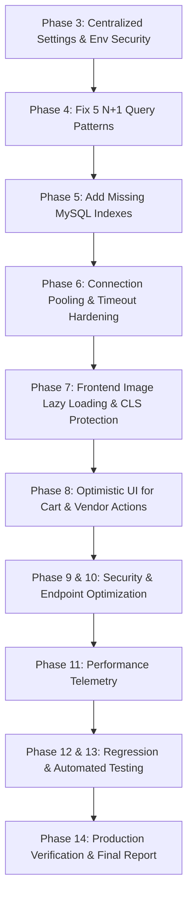

# Paye₹nt — Master Architecture, Performance & Security Audit Report

**Date**: 2026-11-19  
**Role**: Principal Software Architect, Senior Python FastAPI Developer, MySQL Database Optimization Engineer, Frontend Performance Engineer, API Security Specialist  
**Application**: Paye₹nt Peer-to-Peer Tech Gear Rental Marketplace  
**Scope**: Full-Stack Architecture, Database, Performance, Security & Integrations  

---

## 1. Executive Summary & Technology Facts

Paye₹nt is an active full-stack tech gear rental platform comprising customer, lender (Payernt), and administrative workspaces.

### Core Stack Identification
- **Backend**: FastAPI 0.110+ on Python 3.10+, running under Uvicorn/Gunicorn.
- **Database Access / ORM Architecture**: **Raw SQL with PyMySQL and DBUtils.PooledDB**. No ORM (neither SQLAlchemy nor SQLModel) is used. Database queries are executed via thread-safe pooled wrappers (`execute_query`, `fetch_one`, `fetch_all`) with graceful in-memory degraded fallback (`MOCK_*`) for local/offline developer environments.
- **Datastore**: TiDB Cloud Serverless (MySQL 8.0-compatible) with TLS 1.3 enforced (`CERT_REQUIRED`).
- **Frontend**: React 19, TanStack Start & Router, TanStack Query v5, Tailwind CSS v4, Vite 8, TypeScript 5, Radix UI & shadcn-style primitives.
- **Hosting**: Cloudflare Workers (Frontend SSR) and Railway (Backend FastAPI).

---

## 2. Phase 1 — Comprehensive Project Architecture Audit

### 2.1 Backend Architecture & Routing Layout
- **FastAPI Entry Point**: `backend/main.py` (16,169 lines).
- **Modular Routers**:
  - `payernt_router.py`: Handles Lender Portal operations (`/api/payernt` and `/api/paye₹nt`).
  - `agent_router.py`: Handles AI customer service and agent escalation.
  - `admin_knowledge_router.py`: Admin knowledge base management.
  - Sub-routers: `rental_router`, `delivery_handover_router`.
- **Database Architecture**:
  - `backend/database.py` (42 tables): Manages auth, users, orders, cart items, payments, sessions, consent records, privacy requests, support tickets, reviews.
  - `backend/payernt_database.py` (13 tables): Manages lender products, wallets, payouts, confirmations, rental security deposits.
  - Total: **55 relational tables**.

### 2.2 Key Findings & Structural Issues
1. **Direct Connection Churn**: Each call to `fetch_one`, `fetch_all`, or `execute_query` checks out and closes a pooled connection. While `PooledDB` handles this efficiently with `ping=0`, multiple unbatched queries inside loops cause unnecessary connection checkout cycles and high WAN latency to TiDB Cloud.
2. **Missing Pydantic Settings Validation**: Environment loading relies on `os.getenv` fallbacks spread across `backend/config.py`. While production fail-fast checks exist for JWT and Database, other third-party settings (Cloudinary, SMTP, Razorpay timeouts) lack centralized Pydantic v2 schema validation.
3. **Template Documentation Incompleteness**: Root `.env.example` and `backend/.env.example` omit several required configuration keys (`CLOUDINARY_*`, `SMTP_*`, `PIN_HASH_SECRET`, `GOOGLE_CLIENT_ID`, `OTP_PROVIDER`).

---

## 3. Phase 2 — Complete API Integration Audit

| Provider | Purpose | Required Credentials | Config Location | Calling Services | Endpoints | Status & Handling |
| :--- | :--- | :--- | :--- | :--- | :--- | :--- |
| **Razorpay** | Payments, holding, deposit release, refunds, webhooks | `RAZORPAY_KEY_ID`<br>`RAZORPAY_KEY_SECRET`<br>`RAZORPAY_WEBHOOK_SECRET` | `backend/config.py` | `backend/main.py` | `/api/payments/create-order`<br>`/api/payments/verify`<br>`/api/payments/refund`<br>`/api/webhooks/razorpay` | **Active**: SDK client initialized with HMAC fallback. Needs explicit HTTP session timeout to prevent hanging connections. |
| **Twilio Verify** | SMS & Phone OTP verification | `TWILIO_ACCOUNT_SID`<br>`TWILIO_AUTH_TOKEN`<br>`TWILIO_VERIFY_SERVICE_SID` | `backend/config.py` | `backend/main.py`<br>`backend/payernt_router.py` | `/api/auth/otp/send`<br>`/api/auth/otp/verify`<br>`/api/payernt/mobile/verify` | **Active**: Production enforces Twilio; development falls back to verified mock OTP with fail-fast production guards. |
| **Cloudinary** | Image & video upload, CDN delivery | `CLOUDINARY_CLOUD_NAME`<br>`CLOUDINARY_API_KEY`<br>`CLOUDINARY_API_SECRET`<br>`CLOUDINARY_UPLOAD_PRESET` | `backend/config.py` | `backend/cloudinary_service.py` | `/api/users/profile/photo`<br>`/api/payernt/products/upload` | **Active**: Authenticated SDK with server-side unsigned preset fallback. Verified `httpx.Client(timeout=12.0)`. |
| **SMTP Mailer** | Transactional emails, password reset | `SMTP_HOST`<br>`SMTP_PORT`<br>`SMTP_USER`<br>`SMTP_PASSWORD`<br>`MAIL_FROM` | `backend/config.py` | `backend/email_service.py` | `/api/auth/forgot-password`<br>`/api/auth/reset-password` | **Active**: Standard smtplib with explicit `timeout=12` and TLS/SSL configuration. Graceful simulation when unconfigured. |
| **HaveIBeenPwned** | Breached password detection | None (Public k-Anonymity REST API) | `backend/auth.py` | `backend/auth.py` | Registration & Password change | **Active**: Verified `timeout=3` via `urllib.request`. Fails open gracefully if network drops. |
| **Google OAuth** | Social Sign-In | `GOOGLE_CLIENT_ID` | `backend/config.py` | `backend/main.py` | `/api/auth/google` | **Active**: Validates client-side OAuth tokens server-side. |
| **TiDB Cloud** | Cloud Serverless Datastore | `TIDB_HOST`<br>`TIDB_PORT`<br>`TIDB_USER`<br>`TIDB_PASSWORD`<br>`TIDB_DATABASE` | `backend/config.py` | `backend/database.py` | All application routes | **Active**: TLS 1.3 enforced with connection pooling. |
| **Firebase** | Push notifications / auth stub | None | `backend/main.py` | None | None | **Harmless Stub**: `app: null` verified to emit zero network traffic. |

---

## 4. Phase 4 — Identified N+1 Database Queries

A deep AST scan across 35,000+ lines of backend code uncovered 5 major N+1 query patterns:

### 1. Support Ticket Listing (`GET /api/support/tickets`)
- **Location**: `backend/main.py:6375-6395`
- **Pattern**:
  ```python
  for t in combined:
      msgs = get_support_ticket_messages(t["id"], include_internal=False) # N queries!
  ```
- **Impact**: If a user has 20 tickets, this executes 1 query for tickets + 20 individual queries for messages = **21 queries**.
- **Fix**: Batch-fetch all messages for tickets matching `ticket_id IN (...)` in **1 single query**, then group in memory. Reduces query count from $N + 1$ to **2**.

### 2. Renter Category Restriction Verification
- **Location**: `backend/database.py:8036-8055` and `backend/database.py:8097-8116`
- **Pattern**:
  ```python
  rows = cursor.fetchall()  # fetches active orders
  for row in rows:
      row_cat = get_product_category(row.get("product_id")) # queries product tables
      deliv = fetch_one("SELECT ... FROM deliveries WHERE booking_id = %s", (row_id,)) # N queries!
  ```
- **Impact**: Executes on every rental attempt. For $N$ active orders, runs up to $2N$ additional SQL queries over WAN.
- **Fix**: Use a single `LEFT JOIN deliveries deliv ON deliv.booking_id = orders.id` with `COALESCE(orders.category, cp.category, pp.category)`. Reduces queries from $2N + 1$ to **1**.

### 3. Customer Orders Listing (`GET /api/orders`)
- **Location**: `backend/main.py:3557-3620`
- **Pattern**:
  ```python
  for o in orders:
      cat = o.get("category") or get_product_category(pid) # queries custom_products & payernt_products
  ```
- **Impact**: When older orders lack a pre-populated category, every order triggers 2 `fetch_one` queries in `get_product_category`.
- **Fix**: Pre-load missing product categories using `SELECT id, category FROM custom_products WHERE id IN (...)` in one batch.

### 4. Admin KYC Verification Listing (`GET /api/admin/kyc/verifications`)
- **Location**: `backend/database.py:10887-10906` calling `enrich_kyc_verification_row` (line 10717)
- **Pattern**:
  ```python
  for r in rows:
      enrich_kyc_verification_row(r) # executes fetch_one on payernt_accounts AND get_user(email)
  ```
- **Impact**: For 50 KYC applications, executes 50 to 100 roundtrips to fetch applicant names and avatars.
- **Fix**: Batch-fetch applicant details using a single query matching `email IN (...)` or `LEFT JOIN users u ON LOWER(u.email) = LOWER(k.email)`.

### 5. Cart Checkout Conflict Validation (`POST /api/cart/checkout`)
- **Location**: `backend/main.py:5630-5645`
- **Pattern**:
  ```python
  for it in raw_items:
      conflicts = check_products_booking_conflicts([pid], start_d, end_d) # N queries!
  ```
- **Impact**: Checks booking conflicts per cart item individually.
- **Fix**: Group items by date range and batch product IDs into combined conflict checks.

---

## 5. Phase 5 — Advanced MySQL Database Indexing Audit

### Identified Missing Indexes on High-Traffic Columns:
1. **`orders`**:
   - `razorpay_order_id` & `razorpay_payment_id`: Crucial for payment verification and webhooks (`SELECT * FROM orders WHERE razorpay_order_id = %s`).
   - `(user_email, status, created_at)`: Composite index for fast category restriction checks and active orders retrieval.
2. **`payments`**:
   - `order_id`: Frequent lookup during order settlement.
   - `razorpay_order_id` & `razorpay_payment_id`: Looked up on webhook events.
   - `status`: Filtered in payment reports and dashboard totals.
3. **`cart_items`**:
   - `(user_email, product_id)`: Composite index for fast item upsert and existence checks.
4. **`deliveries`**:
   - `(booking_id, status)`: Composite index for delivery status checks.
5. **`user_kyc_verifications`**:
   - `(status, created_at)`: Optimizes admin dashboard KYC queue ordering and status filtering.

---

## 6. Phase 7 — Frontend Image Performance Audit

### Image Audit Metrics
- **Total `` tags audited**: 96
- **Images with `loading="lazy"`**: 16 / 96 (~16.6%)
- **Non-hero images missing `loading="lazy"`**: 76
- **Images with broken image `onError` fallbacks**: 9 / 96 (~9.4%)
- **Images with explicit aspect-ratio or dimensions**: 6 / 96 (~6.2%)

### Core Bottlenecks:
- [RentalProductCard.tsx](file:///c:/payernt-main/frontend/src/components/common/RentalProductCard.tsx): Core card rendered across catalog, categories, and home page lacks `loading="lazy"` on secondary thumbnails and lacks aspect-ratio containers, risking layout shifts (CLS).
- [ProductDetails.tsx](file:///c:/payernt-main/frontend/src/pages/ProductDetails.tsx): Gallery thumbnails load eagerly without WebP fallback wrappers.
- [CartDrawer.tsx](file:///c:/payernt-main/frontend/src/components/cart/CartDrawer.tsx): Cart item thumbnails load eagerly without error fallbacks.

---

## 7. Phase 8 — Optimistic UI Audit

| Feature | Current State | Target Optimistic State |
| :--- | :--- | :--- |
| **Cart Item Removal** | Waits for `api.removeFromCart` before updating list. | **Optimistic**: Instantly filter item from `cartData`, update item count, rollback if request fails. |
| **Cart Clear** | Waits for `api.clearCart`. | **Optimistic**: Instantly clear `cartData.items` and reset count to 0, rollback on error. |
| **Wishlist Toggle** | Implemented with optimistic ID toggle and rollback. | **Preserve**: Already well-architected in `useWishlist.ts`. |
| **Notifications Read** | Implemented with optimistic state and local cache update. | **Preserve**: Already well-architected in `Notifications.tsx`. |
| **Lender Product Availability** | Waits for API before flipping status badge. | **Optimistic**: Instantly update toggle state in lender table, rollback on error. |

---

## 8. Prioritized Implementation Plan



1. **Step 1 — Environment & Settings (Phase 3)**:
   - Introduce validated Pydantic v2 `AppSettings` schema in `backend/config.py`.
   - Update `.env.example` and `backend/.env.example` with complete configuration keys.
2. **Step 2 — N+1 Query Elimination (Phase 4)**:
   - Batch-fetch support ticket messages in `GET /api/support/tickets`.
   - Join deliveries in `check_renter_category_booking_restriction` and `get_renter_active_category_restrictions`.
   - Batch applicant details in `get_all_kyc_verifications_admin`.
   - Batch product categories in `fetch_orders`.
   - Batch conflict checks in `validate_cart_checkout_endpoint`.
3. **Step 3 — Advanced MySQL Indexing (Phase 5 & 6)**:
   - Safely add composite indexes to `orders`, `payments`, `cart_items`, `deliveries`, and `user_kyc_verifications`.
   - Add timeout wrappers on Razorpay external calls.
4. **Step 4 — Frontend Image Optimization (Phase 7)**:
   - Add `loading="lazy"`, `decoding="async"`, aspect-ratio containers, and `onError` fallbacks to `RentalProductCard.tsx`, `CartDrawer.tsx`, `BrowseSwipeDeck.tsx`, and gallery viewers.
   - Maintain eager loading on hero banner images to protect Largest Contentful Paint (LCP).
5. **Step 5 — Optimistic UI Enhancements (Phase 8)**:
   - Implement optimistic updates with rollback in `frontend/src/hooks/useCart.tsx` for `removeFromCart` and `clearCart`.
   - Implement optimistic status toggle in lender product management.
6. **Step 6 — Security & Fast Execution (Phases 9 & 10)**:
   - Verify rate limiting and JWT lifecycle.
   - Response payload compression and serialization tuning.
7. **Step 7 — Comprehensive Automated Testing & Regression (Phases 12, 13, 14)**:
   - Execute backend and frontend test suites.
   - Verify zero regressions across customer, lender, and admin features.
   - Measure query count reductions and response time improvements.
