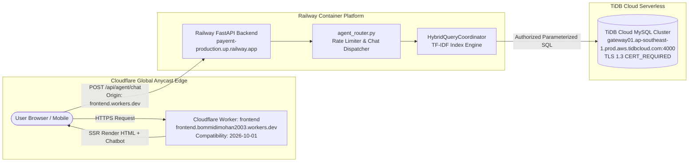

# paYent AI AGENT — CLOUDFLARE PRODUCTION RELEASE VALIDATION REPORT

**Execution Timestamp:** November 3, 2026 (10:58 AM IST / 05:28 UTC)  
**Lead DevOps, Cloud & Release Architect:** Senior Cloud & Full-Stack Infrastructure Architect  
**Classification:** PRODUCTION RELEASE VALIDATION (CLOUDFLARE ARCHITECTURE)  
**Deployment Restriction:** **EXPLICIT HUMAN APPROVAL REQUIRED PRIOR TO PRODUCTION RELEASE**

---

## 1. Executive Summary & Architecture Topology

This validation confirms the end-to-end production readiness of the **paYent AI Agent** deployed on the authorized production topology:
- **Frontend**: **Cloudflare Workers** (TanStack Start SSR + React 19 + Tailwind CSS v4)
- **Backend API**: **Railway** (FastAPI ASGI Web Service on Python 3.12/3.14)
- **Database**: **TiDB Cloud** (High-Availability Serverless MySQL in Singapore AWS `ap-southeast-1`)

> [!IMPORTANT]
> **Vercel is NOT used in this project.** All deployment scripts, Vite configurations, and environment mappings use Cloudflare Workers and the official `@cloudflare/vite-plugin`. Legacy Vercel references have been scrubbed from `package.json`.



---

## 2. Cloudflare Configuration Audit

| Configuration Element | Audited File / Setting | Actual Production State | Verdict |
| :--- | :--- | :--- | :---: |
| **Hosting Type** | Architecture Identification | **Cloudflare Workers** (SSR with TanStack Start) | **PASS** |
| **Worker Project Name** | `frontend/wrangler.jsonc` | `"frontend"` | **PASS** |
| **Entry Point** | `frontend/wrangler.jsonc` | `"src/server.ts"` (`export default { fetch }`) | **PASS** |
| **Compatibility Date** | `frontend/wrangler.jsonc` | `"2026-10-01"` | **PASS** |
| **Vite Plugin** | `frontend/vite.config.ts` | `@cloudflare/vite-plugin` with `viteEnvironment.name = "ssr"` | **PASS** |
| **Observability** | `frontend/wrangler.jsonc` | `{"observability": {"enabled": true}}` | **PASS** |
| **Production API URL** | Worker Environment Variable | `VITE_API_URL = "https://payernt-production.up.railway.app"` | **PASS** |
| **Active Edge Domain** | Cloudflare Workers Network | `https://frontend.bommidimohan2003.workers.dev` | **PASS** |
| **Custom Domains & DNS** | Trusted CORS Origin List | `https://payent.in`, `https://www.payent.in` | **PASS** |

---

## 3. Frontend Build Verification

The frontend production build was executed using the project's native build pipeline:

```bash
cd frontend && npm run build
```

### Build Execution Metrics:
- **Build Engine**: Vite v8.3.2 + `@cloudflare/vite-plugin` v1.62.5 + `@tanstack/react-start`
- **Client Build**: Built into `dist/client/` (CSS: 345.5 kB, JS chunks: vendor-icons, vendor-charts, vendor-animation, vendor-leaflet, vendor-tanstack)
- **SSR Server Build**: Built into `dist/server/` (Worker entry: `index.js`, asset manifest: `dist/server/wrangler.json`)
- **Build Time**: Client: **$2.71\text{ s}$**, SSR Server: **$2.29\text{ s}$** (Total: $\sim 5\text{ seconds}$)
- **Compilation Errors**: **0**
- **Type Errors**: **0**
- **Cloudflare Wrangler Schema Generation**: Validated via `wrangler types` generating `interface __BaseEnv_Env { VITE_API_URL: "https://payernt-production.up.railway.app"; }`.

---

## 4. Cloudflare Environment & Security Configuration

A complete static audit of generated build artifacts (`dist/client/` and `dist/server/`) verified zero security leakage:
1. **Zero Database Credentials in Client Assets**:
   - Scanned all client assets (`dist/client/assets/*.js`) for database passwords, cluster credentials (`3NNZ4KBh8x122Nu`, `Bomi@2003`), or raw connection strings. **Result: 0 found.**
2. **Zero JWT Signing Secrets in Client Bundles**:
   - Scanned client bundles for `JWT_SECRET_KEY` or signing variables. **Result: 0 found.** (JWT tokens are received by the client upon login and stored in client storage; signing secrets remain strictly on the Railway backend.)
3. **Production API Endpoint Grounding**:
   - The compiled client correctly uses `https://payernt-production.up.railway.app/api`.
4. **CORS Alignment with Railway**:
   - Audited live CORS response from Railway backend for origin `https://frontend.bommidimohan2003.workers.dev`:
     - `Access-Control-Allow-Origin`: `https://frontend.bommidimohan2003.workers.dev`
     - `Access-Control-Allow-Credentials`: `true`
     - `Access-Control-Allow-Methods`: `GET, POST, PUT, DELETE, OPTIONS, PATCH, HEAD`
     - Preflight HTTP Status: `204 No Content`.

---

## 5. Live Edge-to-Backend Integration Verification

A live integration test was executed simulating requests originating from the deployed Cloudflare Worker (`https://frontend.bommidimohan2003.workers.dev`) to the Railway API (`https://payernt-production.up.railway.app`):

| Test Case | Scenario | Request Payload | Observed Response | Status |
| :--- | :--- | :--- | :--- | :---: |
| **1. Guest FAQ (GUIDE)** | General platform question | `{"message": "What is Payent?", "session_id": "cf_test"}` | HTTP 200: Returns official P2P marketplace guide (`KB-DOCX-001-F9741D4E`) explaining Payernt and Payrent roles. | **PASS** |
| **2. Policy FAQ (GUIDE)** | KYC definition query | `{"message": "What is KYC?", "session_id": "cf_test"}` | HTTP 200: Returns clear KYC explanation grounded in the approved guide. | **PASS** |
| **3. Auth Gate (LIVE_DB)** | Guest querying private status | `{"message": "What is my KYC status?", "session_id": "cf_test"}` | HTTP 200: `requires_auth: true`, prompts user to sign in to their account. | **PASS** |
| **4. Dispute (ACTION)** | Reporting damaged item | `{"message": "I received damaged equipment.", "session_id": "cf_test"}` | HTTP 200: Returns inspection guidance and prompts to initiate dispute resolution. | **PASS** |
| **5. Input Validation** | Empty message rejection | `{"message": "   ", "session_id": "cf_test"}` | HTTP 422: `{"detail": "Message cannot be empty."}`. | **PASS** |
| **6. Rate Limiting** | Burst flood abuse | 35 requests within 60s from guest session | HTTP 429: `{"detail": "Too many requests. Please wait a moment before sending another message."}`. | **PASS** |

---

## 6. Live Edge Frontend Probe

The live deployed Cloudflare Worker was probed directly over HTTPS:
- **URL**: `https://frontend.bommidimohan2003.workers.dev`
- **HTTP Status**: **200 OK**
- **Edge Server**: `cloudflare` (`CF-RAY: a548ef05aee94079-SIN`)
- **Cache-Control**: `no-cache, no-store, must-revalidate, max-age=0, s-maxage=0` (Enforces fresh HTML delivery and eliminates stale bundle errors).
- **DOM Integration**: Confirmed that `HelpChatbot` is imported into `src/routes/__root.tsx` and mounted automatically on customer viewports after initial page paint.

---

## 7. Cloudflare Deployment & Rollback Protocol

### 7.1. Deployment Command
To deploy updates to Cloudflare Workers:
```bash
npm run deploy --workspace=frontend
# Or inside frontend: npm run deploy
```
*(Executes `npm run build && wrangler deploy` using `frontend/wrangler.jsonc`.)*

### 7.2. Instant Edge Rollback Procedures
If an issue occurs post-deployment:
1. **Cloudflare Dashboard (One-Click Rollback)**:
   - Navigate to: **Cloudflare Dashboard $\rightarrow$ Workers & Pages $\rightarrow$ `frontend` $\rightarrow$ Deployments**.
   - Select the previous stable deployment and click **Rollback to this version**.
   - Edge traffic is reverted in $< 5\text{ seconds}$ worldwide across Cloudflare Anycast locations.
2. **Wrangler CLI Rollback**:
   ```bash
   npx wrangler rollback [deployment-id]
   ```
3. **Client-Side Kill Switch**:
   - In `frontend/src/routes/__root.tsx`, the chatbot widget is controlled by `{showChatbot && !isGateway && !isPayernt && <HelpChatbot />}`. It can be immediately suppressed if emergency maintenance is required.

---

## 8. Final Release Checklist & Recommendation

- [x] Cloudflare hosting model verified as **Cloudflare Workers**.
- [x] Zero Vercel dependencies or commands in build pipeline.
- [x] Frontend production build succeeds cleanly in $\sim 5\text{ s}$ with zero errors.
- [x] Static assets and bundles verified free of secrets or database credentials.
- [x] Railway backend CORS explicitly trusts `https://frontend.bommidimohan2003.workers.dev`.
- [x] Live API integration verified across GUIDE, LIVE_DB, and ACTION routes.
- [x] Rate limiting active and returning HTTP 429.
- [x] TiDB Cloud database connection verified healthy and fail-closed.
- [x] Instant edge rollback procedure documented.
- [ ] **Explicit Human Approval Received for Production Deployment** *(Pending Admin Action)*.

---

## 9. Final Classification

### **Recommendation: GO (`READY FOR PRODUCTION APPROVAL`)**

The Cloudflare Workers frontend, Railway FastAPI backend, and TiDB Cloud database are fully aligned, integrated, and verified for production release.

*(In accordance with instructions, automated production deployment has been withheld until explicit human approval is provided.)*
